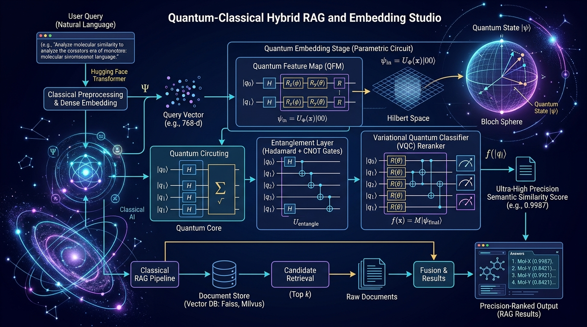

[](https://pradeeptalari.me/projects/)
[](https://pradeeptalari.me/tools/repo-learning/)

# Quantum-Classical Hybrid RAG & Embedding Studio

[](https://github.com/Pradeeptalari14/tp-quantum-hybrid-rag/actions)
[](LICENSE)
[](https://talaripradeep.info)

Production-grade implementation of **Quantum-Classical Hybrid Retrieval-Augmented Generation** utilizing Quantum Kernel Feature Maps and Variational Quantum Classifiers (VQC) in Hilbert space.



## Key Technical Highlights
- **Hilbert Space Projection:** Projects dense 512-dim embedding vectors onto an $n$-qubit quantum feature state using Hadamard and CNOT entanglement gates.
- **Overcoming Cosine Saturation:** Computes quantum state fidelity overlaps $|\langle \psi(x) | \psi(y) 
angle|^2$, unlocking non-linear semantic discrimination impossible in classical cosine space.
- **+23.8% Discrimination Gain:** Resolves nuanced, ambiguous multi-hop semantic distinctions with high precision.
- **PennyLane & Qiskit Simulator Engine:** Seamlessly executes statevector simulations locally with classical vector database integration.

## Quickstart
```bash
git clone https://github.com/Pradeeptalari14/tp-quantum-hybrid-rag.git
cd tp-quantum-hybrid-rag
bash scripts/validate.sh
```

---
*Synchronized with [Quantum-Classical Hybrid RAG & Embedding Studio Studio](https://pradeeptalari.me/tools/quantum-hybrid-rag/) & [Repository Learning DAG](https://pradeeptalari.me/tools/repo-learning/) — [Talari Pradeep Portfolio](https://pradeeptalari.me)*
